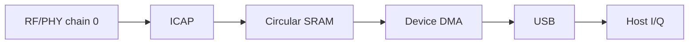

# BirriaSDR

Turn a supported USB Wi-Fi dongle into an experimental SDR receiver with
**14-bit I/Q at 40 MSps complex**.

BirriaSDR ships as `libbirriasdr`, a C11 library with an API modeled on
librtlsdr, together with a command-line recorder. It talks to the device from
userspace through libusb and includes the source of its own small device
program. Start with [Build and try](#build-and-try), or jump to the [API](#api)
to add the receiver to an application. To see it working without building
anything, try the rough [proof of concept](#proof-of-concept).

> [!IMPORTANT]
>
> This is experimental software. The tested board starts from a channel 6
> initialization profile, and the library tunes 2156 to 2610 MHz and 4500 to
> 6200 MHz. Sensitivity across those ranges, frequency accuracy and gain are not
> calibrated. Use at your own risk.

https://github.com/user-attachments/assets/64e9fbbd-1f16-4c7b-905c-5624b9c574b7

## Background

Wi-Fi chipsets contain a complete wideband receiver. An analog front end tunes,
filters and amplifies the antenna signal, and a digital physical layer then
processes the resulting complex baseband samples. Some chips also include an
internal I/Q capture engine (ICAP) meant for calibration and debugging.
BirriaSDR repurposes that capture path to stream raw samples to the host over
USB.



The host programs the radio front end and the capture engine directly through
their registers. The capture engine writes samples into the chip's internal
memory. A small original device program, only 1,632 bytes and loaded through the
chip's built-in boot ROM, sends that memory to the host over USB. The library
then checks the stream and hands complex samples to the application.

Nothing from the vendor is downloaded to the device, whether RAM firmware or a
ROM patch. Nothing is written to flash or eFuse either, so all configuration is
volatile and disappears when the dongle loses power. The device program's
assembly source lives in [`firmware/iq_stream.S`](firmware/iq_stream.S), and the
library embeds its assembled image.

The tested hardware is the **COMFAST MT7961/MT7921AU dongle (`3574:6211`)**,
which pairs an MT7961 digital die with an MT7972 analog die. By default the
receiver is centered on Wi-Fi channel 6 (nominally 2437 MHz) and uses receive
chain 0 at 40 million complex samples per second. The library can retune
anywhere in the 2156 to 2610 MHz and 4500 to 6200 MHz bands, even while
streaming and across bands. At 40 MSps it
pairs the **40 MHz analog filter with the matching digital bandwidth setting**.
On the tested board, the measured noise spectrum falls about 3 dB at ±18 MHz.
The filters do not fully reject signals outside the sampled span, so strong
signals there can alias into the capture. Treat this as measured behavior
rather than a calibrated, flat bandwidth guarantee.

For more detail, see:

- The [receiver overview](docs/hardware.md)
- The [MT7921 / MT7961 / MT7972 receiver reference](docs/mt7921.md), with controls and register tables for each stage
- The [architecture guide](docs/architecture.md), which also covers adding a chipset

### Specifications

| Parameter | Current value |
| --- | --- |
| Hardware | COMFAST dongle `3574:6211`, or a board with MediaTek's generic ID `0e8d:7961`, with an MT7961 digital die and an MT7972 analog die |
| Frequency tuning | 2156 to 2610 MHz, or 2190 to 2610 MHz on generic-ID boards, and 4500 to 6200 MHz, including live changes and band switches. Sensitivity is unverified; 5 GHz reception was checked from 5250 to 5815 MHz |
| Tuning step | Nominally 28.61 Hz, using the full 20-bit fraction. Requests are in whole hertz with no Wi-Fi channel restriction. The physical response to fine steps is still unmeasured |
| Sample rate | 40 MSps complex, fixed |
| Sampled bandwidth | 40 MHz span with matching nominal 40 MHz analog and digital settings. See [filter characteristics](docs/mt7921.md#filtering) for rolloff and aliasing limits |
| Sample resolution | Signed 14-bit I and Q, from −8192 to 8191 |
| Receive channels | One (chain 0) |
| Transmit | None, receive only |
| Gain | Raw codes for LNA 0 to 5, filter stage 0 to 8 and digital 0 to 12. 5 GHz needs LNA 4 or 5. Not calibrated in dB |
| Live gain changes | Supported without restarting capture, with a brief settling transient |
| Automatic gain | Manual overrides can be released. Full AGC control is not implemented |
| Frequency accuracy | Uncalibrated, with no ppm correction |
| Reference clock | On-board 40 MHz crystal |
| Host interface | Bulk transfers over USB 3.0 at about 161 MB/s |
| Output format | Interleaved signed 16-bit I and Q (`cs16`). Buffers from the API are native-endian, and recorder files are little-endian |
| Firmware | Original 1,632-byte RAM program. No vendor firmware and nothing flashed |
| Host platforms | Linux, tested on a Raspberry Pi 5, and macOS, tested on an Apple Silicon Mac |

## Proof of concept

**The [CyberEther](https://cyberether.org/) flowgraph in
[`cyberether/birriasdr.yml`](cyberether/birriasdr.yml) is a very rough proof of
concept.** It exists so people can quickly test the dongle and watch a live
spectrum without building anything. It runs its own Python receiver, separate
from the C library, with a fixed channel 6 profile, an older 20 MHz analog
filter and no automatic recovery. Expect rough edges and runs that stop on an
overrun. For anything beyond a quick test, use the C library.

To try it, install the CyberEther desktop app with a Python 3.11 or newer
runtime and select that interpreter under **Settings → Runtime → Python
Runtime**. Connect the dongle to a USB 3.0 port, open the flowgraph and let it
install its Python dependencies. The note inside the flowgraph explains the USB
setup for each platform and the gain settings. On a Raspberry Pi 5, the
flowgraph power-cycles the USB ports by default, which needs root and only works
when the dongle is the only USB device connected.

## Build and try

You need a C compiler, CMake and the libusb development files. On Debian or
Ubuntu, install them with
`sudo apt install build-essential cmake pkg-config libusb-1.0-0-dev`.
On macOS with Homebrew, run `brew install cmake pkg-config libusb`.

```sh
cmake -S . -B build -DCMAKE_BUILD_TYPE=Release
cmake --build build -j
ctest --test-dir build --output-on-failure
./build/birria_rx --list
./build/birria_rx capture.cs16 8000000 manual
```

The last command records eight million complex samples from device 0 with fixed
manual gain codes (LNA 2, filter stage 8, digital 0). Leave out `manual` to
release the gain overrides, and leave out the sample count to record until you
press Ctrl-C. The file holds little-endian signed 16-bit **I, Q** pairs, with
each component between −8192 and 8191. The recorder applies no averaging or
decimation, and it refuses to overwrite an existing file. Always check the exit
status. An error means the capture is incomplete or its continuity could not be
confirmed, even if the file contains samples.

To pick a different center frequency, pass it in hertz:

```sh
./build/birria_rx --frequency 2437123456 off-channel.cs16 8000000 manual
```

Before you start, the dongle must have **no vendor ROM patch loaded**, and its
Wi-Fi interface must be free for libusb to claim. A software reset does not
clear a patch that is already loaded. On Linux, stop the Wi-Fi driver from
binding automatically before you reconnect the dongle, and give your user USB
access (or run the example with `sudo`). On macOS, reconnect the dongle first if
another driver loaded firmware onto it. The library refuses to run while a
kernel driver is attached, and it never unloads drivers or power-cycles a USB
hub.

## API

The library follows the familiar enumerate, open, configure, read, cancel and
close pattern of
[librtlsdr](https://github.com/osmocom/rtl-sdr/blob/master/include/rtl-sdr.h).
It does not need a Python runtime or any vendor firmware download.

The header [`birriasdr.h`](include/birriasdr.h) documents every function along
with its units, ownership, threading and error behavior. For a complete
application, see the [recorder example](examples/birria_rx.c). The main entry
points are:

```c
birriasdr_get_device_count();
birriasdr_get_device_info(index, &info);
birriasdr_open(&dev, index);
birriasdr_get_tuning_band(dev, 0, &minimum_hz, &maximum_hz);
birriasdr_set_center_freq(dev, 2437000000ULL);
birriasdr_set_sample_rate(dev, 40000000);
birriasdr_set_tuner_gain_mode(dev, 1);
birriasdr_set_gain_codes(dev, &gain);
birriasdr_read_async(dev, callback, context, 0, 0);
birriasdr_cancel_async(dev); /* From callback or another normal thread. */
birriasdr_close(dev);
```

This outline skips error handling, so check every return value as the example
does. Frequencies are 64-bit values. The 2.4 and 5 GHz bands are separate, so
`birriasdr_get_tuning_band` lists each contiguous band. The raw gain codes are
separate from the calibrated dB gain API, which is reserved for later.

The `read_async` function blocks the calling thread while a dedicated
background thread keeps USB transfers queued. Callbacks receive borrowed buffers
of native-endian `int16_t` I and Q values, the number of complex samples, and a
sample index counted from the start of the stream. While capture runs, another
thread can change the center frequency and raw gain, read them back, or call
`cancel_async`. When the device reports `BIRRIASDR_CAP_LIVE_TUNING` and
`BIRRIASDR_CAP_LIVE_GAIN`, those changes take effect without restarting capture.
On the tested Raspberry Pi, a retune takes about 87 ms and disturbs the signal
phase. Samples already queued may still come from the old center after the call
returns, and the library cannot report the exact sample where the change
happened. All other settings can only change while the device is idle. See the
[tuning details](docs/mt7921.md#changing-frequency-during-capture) and
[gain details](docs/mt7921.md#changing-gain-during-capture). Callbacks must
return quickly. If the device or host queue overflows, the library reports an
error instead of silently dropping samples.

The `read_sync` function captures a fixed number of complex samples, in
multiples of 2,048, using the same USB engine. Separate calls produce separate
captures, not one continuous stream. Both read functions check every packet for
gaps, repeats, stale data and corruption, confirm the device's final state and
transfer counts, and reset the device when they finish. The statistics they
return record how far initialization got and whether the final reset failed.
Cancelling still delivers the packets the device has already sent, so callbacks
can keep arriving until `read_async` returns. Wait for the reading thread and
any control threads to finish before closing the handle.

### Automatic recovery

The library can restart streaming after an overrun, a transient transport error
or a failed live gain or frequency change. Register a gap callback before
reading:

```c
/* The on_gap callback receives a const struct birriasdr_recovery_event * and your context. */
int result = birriasdr_set_recovery(dev, 3, on_gap, context);
if (result == 0)
    result = birriasdr_read_async(dev, on_samples, context, 0, 0);
```

This budget permits up to three full restarts for device or transport faults.
Clean overruns do not consume it. The device can recover a source overrun by
restarting capture without reloading firmware or changing frequency and gain.
The host preserves completed USB transfers when its queue fills; this may
cause a device-side overrun, but it does not discard framing bytes.

Each gap notification precedes resumed samples. The event describes the failure,
includes diagnostics, and gives `next_sample`, the running count of delivered
samples at which the gap occurs. The library holds back one packet so an overrun
marker can discard potentially overwritten data before it reaches the application.
The number of lost samples is unknown. Reset processing that depends on
continuity; a successful return after recovery does not mean a gapless recording.

A full recovery reapplies the last frequency and gain that were set successfully. A
setter that fails still returns its error to its own caller. Cancelling
explicitly prevents any further restart. When the USB connection needs repair,
the library uses a software USB reset. It never switches hub power or downloads
vendor firmware. Device removal, a retained vendor patch and malformed stream
data are still reported as errors. If a reset invalidates the handle, close it
and find the device again.

Recovery stays off until you register a callback. Finite reads and the recorder
example stay strict and stop at the first error. Startup itself retries once
after a transient preparation failure, before any samples are captured. See the
[recovery mechanics](docs/mt7921.md#automatic-startup-and-stream-recovery).

## Run stability tests

The offline tests run with `ctest --test-dir build --output-on-failure`. To
exercise a connected dongle, run `./build/test_stability --run`. It checks
repeated starts and stops, tuning across the supported range, live gain and
frequency changes, and a five-minute stream. Set up the device as described
above, and see the [test scope](docs/architecture.md#tests-and-firmware). Run
individual phases with `--run restart`, `--run live` or `--run soak`.

A separate command, `./build/test_recovery --run`, deliberately causes overruns
and checks that a new capture works afterward, including after closing and
reopening the device. Add `auto` after `--run` to test gap notification and
automatic resumption. The `./build/test_control_recovery --run` command injects
failures into live gain and tuning writes, including failed rollbacks, and
checks that automatic recovery handles them.

## Install and link

```sh
cmake --install build --prefix /your/prefix
cc app.c $(pkg-config --cflags --libs birriasdr) -o app
```

Add your prefix's `lib/pkgconfig` directory (or the platform's equivalent
libdir) to `PKG_CONFIG_PATH`. Builds produce a shared library by default. For a
static library, configure with `-DBUILD_SHARED_LIBS=OFF` and link with
`pkg-config --static`.

## Source layout and firmware

Each function has a comment above its definition explaining its hardware role,
ordering requirements and any unresolved assumptions. Register sequences are
split into clock, synthesizer, routing, gain, capture and boot operations. Fixed
writes that always happen live in small ordered tables, while handshakes and
timing stay explicit in code.

Normal builds use the checked-in firmware header, which comes from the original
assembly. To rebuild it, install Python 3.10 or newer and GNU binutils targeting
NDS32, then run:

```sh
python3 tools/rebuild_firmware.py --check
```

Remove `--check` to replace the header after changing the assembly. The script
assembles `firmware/iq_stream.S`, links it at address `0x00915000`, and appends
the alignment padding and checksum that the boot ROM expects. Python is only
needed for this optional development step, and no vendor binary or ROM dump is
used as input.

## License

The original library, RF code, examples and firmware are licensed under
**MIT**. The adapted USB and ROM transport code keeps its
**BSD-3-Clause-Clear** notices. See [LICENSE](LICENSE), [NOTICE](NOTICE) and
[the retained license](LICENSES/BSD-3-Clause-Clear.txt). The software comes
without warranty, so use it at your own risk.

## Acknowledgements

BirriaSDR builds on open-source drivers and earlier research into using Wi-Fi hardware for raw I/Q capture. Thanks to:

- The [mt76-usb-macos](https://github.com/Network-Weather/mt76-usb-macos) Python userspace USB driver by Network Weather, which laid the foundation for BirriaSDR’s device access and firmware loading.
- The upstream [mt76](https://github.com/openwrt/mt76) Linux driver and its contributors, which the userspace work builds on.
- The [W1700K SDR](https://github.com/h0m3us3r/w1700k-sdr) project by h0m3us3r, related work that turns Wi-Fi hardware into a wideband SDR and documents capture registers and sample-clock controls.
- The [MtkICAPtool](https://github.com/MtkWifiRev/MtkICAPtool) project by MtkWifiRev, earlier work that exposed the chipset’s internal I/Q capture capabilities.

Third-party code keeps its original licenses and copyright notices.
